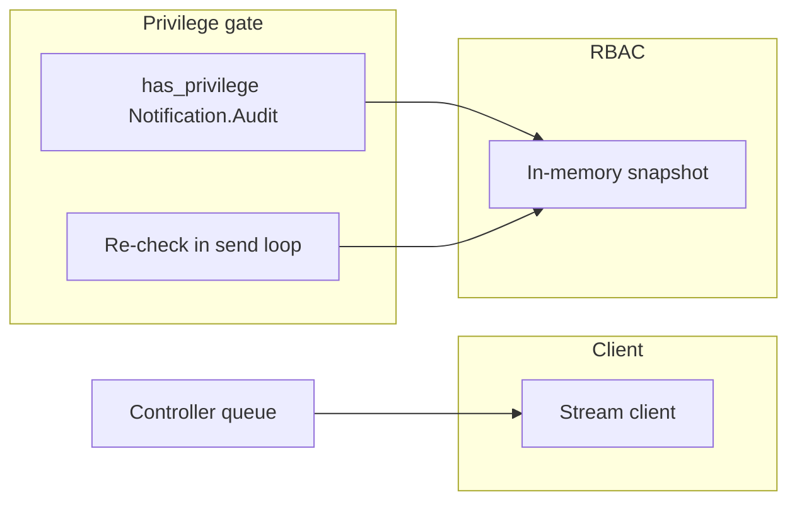
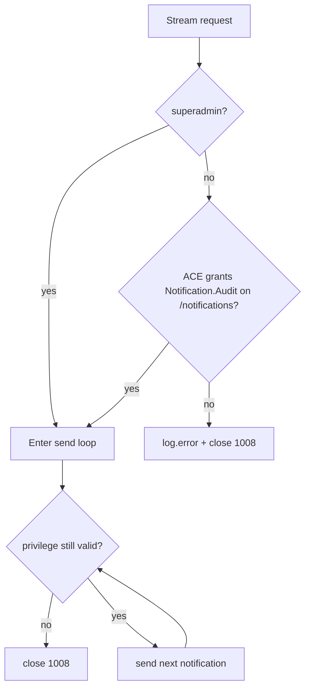

# Global Notification Stream (RBAC)

## Overview

The global controller notification stream (the HTTP NDJSON stream on `/v3/notifications` and the WebSocket on `/v3/notifications/ws`) requires the `Notification.Audit` privilege. Any authenticated user used to receive every controller event, including host statistics (CPU, memory, disk) carried by the `ping` action. By default only superadmins receive the stream now: no default ACE carries the privilege, and no built-in role below "Administrator" holds it.

A stream that is already open when the privilege is revoked is closed by the server on the next ping tick (at most 5 seconds).

Because regular clients lose the stream, `GET /computes` now carries the state they used to sense through it: the runtime state of every compute (connected flag, last error, usage) merged into the database rows, plus the built-in local compute appended to the list.

## Terms

| Term | Meaning |
|---|---|
| Global stream | The controller-scoped notification stream, shared by all clients, as opposed to the per-project and marker streams |
| Ping tick | The queue guarantees a `ping` notification at least every 5 seconds, which bounds the send loop iteration and the privilege re-check |
| Runtime state | Fields that only exist on the in-memory compute (connected, last_error, cpu/memory/disk usage), absent from the database rows |

## Architecture

The privilege check runs as a route dependency when the connection opens, then again inside the send loop on every iteration (bounded by the ping tick). Both paths evaluate against the process-wide RBAC snapshot; the re-check only opens a database session when an administrative write marked the snapshot outdated.

## Business Process

### Connect and stream

A denied WebSocket reports the same shape as an authentication failure: one `log.error` notification, then a 1008 close.

### Sensing computes without the stream

`GET /computes` returns every compute the controller knows: each database row overlaid with its runtime state, then the local compute appended (it never goes to the database). The capabilities payload stays out of the list; clients that need it fetch a compute individually. Polling the list replaces the `compute.*` events for clients without the stream privilege.

## API Endpoints

| Method | Path | Description | Privilege |
|---|---|---|---|
| `GET` | `/v3/notifications` | HTTP NDJSON stream of controller notifications | `Notification.Audit` |
| `WS` | `/v3/notifications/ws` | WebSocket stream, one notification per text frame | `Notification.Audit` |
| `GET` | `/v3/computes` | All computes with runtime state, local included | `Compute.Audit` |
| `GET` | `/v3/computes/{compute_id}` | One compute, runtime state and capabilities included | `Compute.Audit` |

## Notes

- **Default state**: the privilege exists but no default ACE carries it, so only superadmins (who bypass the checks) connect out of the box.
- **Administrator role**: the role holds every privilege on a new database, and the migration attaches this one to it on existing databases; a user with the role still needs an ACE on `/notifications` (or `/`) to reach the stream.
- **Escape hatch**: an administrator grants the stream with an explicit ACE on `/notifications` carrying a role that holds the privilege, like any other resource.
- **Revocation window**: an open stream survives at most one ping tick (5 seconds) after the ACE or role is removed.
- **Ping payload**: the host statistics in `ping` are part of what the privilege protects; clients that legitimately need host usage use the statistics endpoint gated by `Server.Audit`.
- **Upgrade**: the migration inserts the privilege when missing and attaches it to the "Administrator" role; the unversioned-database startup path applies the same steps.
- **WebUI**: views that relied on the global stream for compute events switch to polling `GET /computes`; the list now includes the local compute and live state, which it previously lacked entirely.
