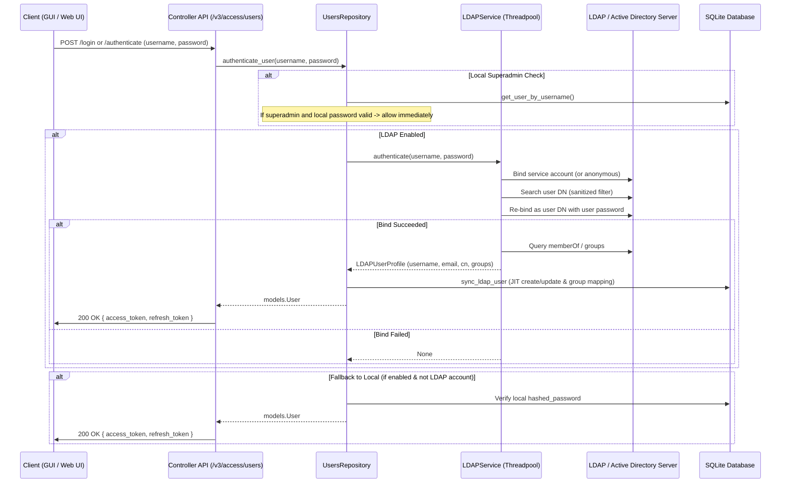

# Native LDAP and Active Directory Authentication

## Overview

GNS3 v3 supports centralized directory authentication via Lightweight Directory Access Protocol (LDAP) and Microsoft Active Directory (AD). This enables organizations to authenticate users against central identity stores, automatically provision user accounts into GNS3 via Just-In-Time (JIT) provisioning, and map corporate directory groups to GNS3 Role-Based Access Control (RBAC) groups.

### Key Capabilities
- **Decoupled Architecture:** Client applications (`gns3-gui`, `gns3-web-ui`, CLI) require zero protocol changes; credential verification and token minting occur on the server.
- **Just-In-Time (JIT) Provisioning:** Users are automatically created in GNS3 upon their first successful directory login.
- **Group-to-RBAC Mapping:** Directory security groups (`memberOf` or group queries) map dynamically to GNS3 `UserGroup`s (`Administrators`, `Users`, custom groups).
- **Transport Security:** Full support for LDAPS (`ldaps://`, port 636) and StartTLS (port 389) with certificate verification and custom CA bundles.
- **Emergency Superadmin Fallback:** The local `admin` superadmin account is always evaluated first against the local database, guaranteeing administrative recovery during directory outages.
- **Diagnostic Testing:** Native test connection endpoint (`POST /v3/settings/ldap/test`) to validate connectivity, bind credentials, and search queries before saving.

---

## Architecture



---

## Configuration Reference

LDAP settings are configured in `gns3_server.conf` under the `[LDAP]` section or managed via `PUT /v3/settings`.

| Setting | Type | Default | Description |
| :--- | :--- | :--- | :--- |
| `enabled` | `bool` | `False` | Enable LDAP/Active Directory authentication. |
| `uri` | `str` | `ldap://localhost:389` | LDAP URI (`ldap://host:port` or `ldaps://host:port`). |
| `bind_dn` | `str` | `None` | Service account DN for directory searches (optional for anonymous). |
| `bind_password` | `secret` | `None` | Password for `bind_dn`. Masked as `**********` in API responses. |
| `base_dn` | `str` | `""` | Search base DN for locating user objects. |
| `user_search_filter` | `str` | `(&(objectClass=person)(|(uid={username})(sAMAccountName={username})))` | Filter template to find users. `{username}` is safely escaped. |
| `user_attr_username` | `str` | `uid` | Attribute containing the canonical login name (`sAMAccountName` in AD). |
| `user_attr_email` | `str` | `mail` | Attribute containing user email address. |
| `user_attr_fullname` | `str` | `cn` | Attribute containing user full display name (`displayName` or `cn`). |
| `group_search_base` | `str` | `None` | Base DN for group queries (defaults to `base_dn` if empty). |
| `group_search_filter` | `str` | `(&(objectClass=groupOfNames)(member={user_dn}))` | Filter template for directory group searches. |
| `group_mapping` | `dict` | `{}` | JSON map of LDAP group CN/DN to GNS3 `UserGroup` name. |
| `default_group` | `str` | `Users` | Default GNS3 `UserGroup` assigned if no mapped groups match. |
| `start_tls` | `bool` | `False` | Upgrade cleartext connection using StartTLS before binding. |
| `verify_cert` | `bool` | `True` | Verify TLS certificates for LDAPS / StartTLS. |
| `ca_cert_file` | `str` | `None` | Path to custom CA certificate bundle file. |
| `fallback_to_local` | `bool` | `True` | Allow local database accounts to log in if LDAP check fails. |
| `timeout` | `int` | `10` | Socket connect/read timeout in seconds (1 to 120). |

---

## Configuration Examples

### Active Directory (LDAPS)

```ini
[LDAP]
enabled = True
uri = ldaps://dc1.example.com:636
bind_dn = CN=gns3-svc,OU=ServiceAccounts,DC=example,DC=com
bind_password = ServiceAccountSecretPassword
base_dn = OU=Employees,DC=example,DC=com
user_search_filter = (&(objectClass=user)(sAMAccountName={username}))
user_attr_username = sAMAccountName
user_attr_email = mail
user_attr_fullname = displayName
group_mapping = {"GNS3-Admins": "Administrators", "Network-Engineers": "Users"}
default_group = Users
verify_cert = True
ca_cert_file = /etc/ssl/certs/corporate-root-ca.pem
fallback_to_local = True
timeout = 10
```

### OpenLDAP / FreeIPA (StartTLS)

```ini
[LDAP]
enabled = True
uri = ldap://ldap.example.com:389
start_tls = True
bind_dn = cn=admin,dc=example,dc=com
bind_password = AdminSecretPassword
base_dn = ou=people,dc=example,dc=com
user_search_filter = (&(objectClass=inetOrgPerson)(uid={username}))
user_attr_username = uid
user_attr_email = mail
user_attr_fullname = cn
group_search_base = ou=groups,dc=example,dc=com
group_search_filter = (&(objectClass=groupOfNames)(member={user_dn}))
group_mapping = {"cn=netops,ou=groups,dc=example,dc=com": "Administrators"}
default_group = Users
fallback_to_local = True
```

---

## Diagnostics & Connection Testing

Administrators with `Server.Modify` privileges can test LDAP settings and canary queries via the REST API or Web UI:

### Endpoint: `POST /v3/settings/ldap/test`

```bash
curl -X POST http://localhost:3080/v3/settings/ldap/test \
  -H "Authorization: Bearer <ADMIN_TOKEN>" \
  -H "Content-Type: application/json" \
  -d '{
    "enabled": true,
    "uri": "ldaps://dc1.example.com:636",
    "bind_dn": "CN=gns3-svc,OU=ServiceAccounts,DC=example,DC=com",
    "bind_password": "ServiceAccountSecretPassword",
    "base_dn": "OU=Employees,DC=example,DC=com"
  }'
```

### Response
```json
{
  "status": "success",
  "bind_successful": true,
  "user_search_successful": true,
  "users_found": 5,
  "latency_ms": 34.2,
  "message": "Successfully connected to LDAP server in 34.2ms. Found 5 sample user(s) in base DN."
}
```

---

## Security & Architectural Guarantees

1. **Injection Neutralization (CWE-90):** All query variables are sanitized using `ldap3.utils.conv.escape_filter_chars` to neutralize LDAP filter breakout attacks.
2. **Anonymous Bind Defense (CWE-287):** Empty or whitespace-only password attempts are rejected before contacting the LDAP server.
3. **Passwordless Login Defense (CWE-287):** Directory accounts (`auth_source == "ldap"`) cannot use local database recovery fallbacks.
4. **Transport Encryption Ordering (CWE-319):** StartTLS negotiation executes prior to transmitting bind credentials over the network.
5. **Credential Immutability (CWE-284):** Password update endpoints (`PUT /v3/access/users/{id}` and `PUT /v3/access/users/me`) reject password change attempts on directory users with `HTTP 400 Bad Request`.
6. **Non-Blocking Concurrency:** All network I/O executes in background threads (`asyncio.to_thread`), preventing denial of service on FastAPI's async event loop.
7. **Cleartext Transmission Warning (CWE-319):** If LDAP authentication is enabled while native SSL is disabled (`Server.enable_ssl = False`), `gns3server` emits a prominent warning at startup and settings modification, alerting administrators to front the server with an HTTPS reverse proxy.
8. **Automated Lockout Protection (CWE-307):** Built-in in-memory sliding-window rate limiting tracks failed authentication attempts per `(username, client_ip)`. Exceeding 5 failures within 60 seconds immediately aborts with `HTTP 429 Too Many Requests` before hitting the directory server, preventing attackers from triggering enterprise Active Directory account lockout policies.

---

## Operational Lifecycle & Administration

### 1. Dynamic Group Recomputation & Entitlement Revocation
Group memberships for directory accounts are dynamically recomputed during every successful authentication:
- **Membership Ledger (`ldap_groups`):** The server tracks groups explicitly granted by directory synchronization in a dedicated JSON ledger on the user record.
- **Selective Revocation:** When an employee is removed from an Active Directory group (or when `group_mapping` is updated in GNS3), the recomputation routine compares current directory groups against previously granted groups. Removed entitlements are automatically revoked.
- **Manual Overwrite Warning:** Managed groups are recomputed on *each* login. If an administrator manually adds a directory user to a group governed by `group_mapping` (or the `default_group`) in GNS3, that manual assignment will be wiped at their next login unless the user actually possesses that group in Active Directory. To grant persistent local privileges outside of directory sync, assign the user to a custom local GNS3 group that is *not* present in `group_mapping`.
- **Local Group Preservation:** Manually assigned local GNS3 groups (such as ad-hoc project cohorts, lab distribution groups, or local study groups) that do not originate from directory mappings are preserved and will never be removed by JIT synchronization.

### 2. Token Lifetimes vs. Directory Account Status
- **Token Independence:** GNS3 authentication mints signed JSON Web Tokens (`access_token` valid for 24 hours; `refresh_token` valid for 30 days).
- **Revocation Timing:** Revocation waits for the next login or token refresh. Because JWTs are stateless, disabling an account or removing a group in Active Directory does not kill an in-flight `access_token` until it expires. If an administrator requires immediate severance of an active session, they can deactivate the account via the GNS3 API, or the user's `token_version` can be incremented to immediately invalidate all outstanding access and refresh tokens.

### 3. Username Immutability & Project Asset Integrity
- **Immutable Identity Anchoring:** Directory accounts are anchored to an immutable unique identifier (`entryUUID` in OpenLDAP, `objectGUID` in Active Directory, or user DN) persisted in `external_id`.
- **Directory Renames:** Directory account renames in Active Directory (e.g. changing an employee's `sAMAccountName` or UPN) do *not* follow through to rename the GNS3 `username`. Once provisioned, a user's `username` in GNS3 is strictly immutable. This ensures that on-disk project directories, ACL owner checks, and topology files stamped with the creator's username (`created_by`) are never severed.

### 4. Disaster Recovery (DR) & Local Password Fallback
During directory outages or network isolation:
1. **Local Superadmin Exemption:** The emergency local superadmin (`admin`) is always evaluated against the local SQLite database first, guaranteeing administrative access even if the directory server is completely unreachable.
2. **Local Accounts:** When `fallback_to_local = True`, local database users authenticate against their stored bcrypt password hashes.
3. **Directory Accounts in DR:** By default, directory accounts cannot authenticate using local passwords while LDAP is enabled. In an extended disaster recovery scenario where LDAP is globally disabled (`enabled = False`), a former directory account can log in locally *only* if an administrator has explicitly provisioned a local password hash for that user (`PUT /v3/access/users/{id}`). Passwordless login is strictly prohibited for directory accounts under all circumstances.
4. **Flipping Back to LDAP:** When disaster recovery ends and LDAP is toggled back on (`enabled = True`), any former directory user authenticating with their directory credentials automatically has their `auth_source` flipped back to `"ldap"`, and local password access is once again blocked.

---

## Securing Web UI Communications (Reverse Proxy Architecture)

Because `gns3-web-ui` dynamically negotiates API and WebSocket schemes based on `window.location.protocol`, placing `gns3server` behind an HTTPS reverse proxy automatically upgrades all communication:
- Web UI REST requests (`/v3/access/users/login`) transition to encrypted **HTTPS**, protecting Active Directory credentials against LAN sniffing.
- WebConsole, terminal, and notification streams transition to secure **`wss://`** WebSockets.

### Production Caddy Configuration (Recommended)

```caddy
gns3.example.com {
    tls /etc/ssl/certs/gns3.crt /etc/ssl/private/gns3.key
    reverse_proxy 127.0.0.1:3080
}
```

### Production Nginx Configuration

```nginx
# Rate limit to protect Active Directory accounts against brute-force lockouts
limit_req_zone $binary_remote_addr zone=gns3_login:10m rate=5r/s;

server {
    listen 443 ssl http2;
    server_name gns3.example.com;

    ssl_certificate     /etc/ssl/certs/gns3.crt;
    ssl_certificate_key /etc/ssl/private/gns3.key;
    ssl_protocols       TLSv1.2 TLSv1.3;

    location /v3/access/users/login {
        limit_req zone=gns3_login burst=10 nodelay;
        proxy_pass http://127.0.0.1:3080;
        include proxy_params;
    }

    location / {
        proxy_pass http://127.0.0.1:3080;
        proxy_set_header Host $host;
        proxy_set_header X-Real-IP $remote_addr;
        proxy_set_header X-Forwarded-For $proxy_add_x_forwarded_for;
        proxy_set_header X-Forwarded-Proto $scheme;

        # WebSocket support for WebConsole and real-time notifications
        proxy_http_version 1.1;
        proxy_set_header Upgrade $http_upgrade;
        proxy_set_header Connection "upgrade";
        proxy_read_timeout 86400s;
        proxy_send_timeout 86400s;
    }
}
```
