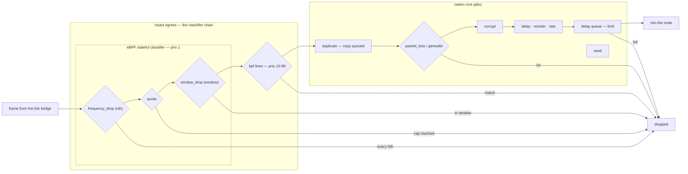

<!--
SPDX-License-Identifier: CC-BY-SA-4.0
See LICENSE file for licensing information.
-->

> This documentation is AI-generated with reference to actual code and verified against real-kernel testing. AI can make mistakes — please verify against the source code when in doubt.

# Packet Filters (link impairments)

## Overview

Per-link impairment filters — delay, packet loss, corruption, rate limiting, deterministic drops — configured through a link's `filters` dict and applied by **both link endpoints**, so every direction of a link is impaired exactly once. A `delay 100` link therefore measures ≈200 ms RTT; `packet_loss 30` measures ≈51 % round trip (1 − 0.7²).

Every kernel-datapath node type shares one implementation: `KernelDatapathMixin` keys everything on the anchor interface name, which is why a Docker adapter's veth host end and a QEMU / IOU / Dynamips adapter's TAP are interchangeable. On the kernel datapath the filters run **in the kernel** as tc objects that uBridge installs over netlink (`tc netem set`, raw netlink — no `tc` binary needed): one netem qdisc, cls_bpf match-drop classifiers and one eBPF stateful classifier per anchor. Relay links run the uBridge userspace filters on the single relay bridge instead — five types there (`delay`, `packet_loss`, `corrupt`, `frequency_drop`, `bpf`); the rest are kernel-only.

## Terms

| Term | Meaning |
|---|---|
| anchor | the host-side interface a link attaches to — a Docker adapter's veth host end, a QEMU / IOU / Dynamips adapter's persistent TAP |
| tc / qdisc | traffic-control objects the kernel inserts into the anchor's egress path — stages frames pass through in flight, not external packet consumers; uBridge only installs them over netlink |
| `clsact` | the tc classifier carrier on the anchor; its egress chain is where the drop classifiers run |
| netem | the impairment qdisc behind clsact: delay, loss, rate, corrupt, duplicate, … |
| eBPF classifier | the stateful drop classifier at clsact egress prio 1 — modes every-Nth, quota, time window and flow (GNS3 exposes the first three as filter types) |
| `bpf_drop` | match-drop BPF expressions at clsact egress prio 10–99 |
| relay filter | a uBridge userspace filter on the relay bridge — both directions cross the single filtered bridge |

## Evaluation order (kernel datapath)

All 13 types in evaluation order for one frame with every filter set — the chain runs once per direction on the destination anchor's egress, the classifier chain first and the single netem qdisc behind it. A drop at any stage ends the frame: whatever the classifiers drop never reaches netem, nor the AF_PACKET tap points — captures and markers will not observe it:



Semantic model rather than kernel source order: the netem draws fire at enqueue (a `duplicate` hit queues a copy alongside the original, `corrupt` damages and passes), `delay`/`reorder`/`rate` fold into one time_to_send that the delay queue drains when due, `limit` is that queue's capacity — the `full` edge above — and `seed` is no stage but the PRNG behind every stochastic draw (duplicate, loss/gemodel, corrupt, jitter). The eBPF program's fourth mode (flow) has no GNS3 filter type, and the attached parameters (jitter, correlation, distribution) ride their types and add no stages. On the relay datapath there is no such chain — the five relay-supported types run as uBridge userspace filters on the single relay bridge, both directions through one filter list.

## Filter types

On the kernel datapath the 13 types ride three kernel objects on the anchor. The `tc …` verbs in the table are uBridge's own hypervisor command names — **not the iproute2 `tc` binary**: uBridge builds every netlink message itself (RTM_NEWQDISC for the netem qdisc, RTM_NEWTFILTER for the cls_bpf and eBPF classifiers), loads the eBPF program through raw `bpf()` syscalls with the instruction array embedded in the binary, embeds the jitter-distribution tables the `tc` CLI would read from disk, and uses libpcap only as a library to compile `bpf` expressions — the same compiler the relay filter uses. The `tc` and `ip` binaries appear only in uBridge's test suite, as kernel-state oracles:

| GNS3 filter | kernel implementation | Notes |
|---|---|---|
| `delay [ms, jitter, dist]` | netem `delay X jitter Y [distribution D]` | jitter 0 omitted; dist ∈ uniform/normal/pareto/paretonormal (kernel-only parameter) |
| `packet_loss [%, correl]` | netem `loss P [correl C]` | per direction (see below); correlation is a kernel-only parameter — and collapses small rates, see the correlation-bias bullet |
| `corrupt [%]` | netem `corrupt P` | |
| `duplicate [%, correl]` | netem `dup P [correl C]` | kernel-only type |
| `rate ["512kbit"]` | netem `rate B` | tc-style integer+unit (bit/kbit/mbit/gbit/bps/kbps/mbps, ≤100gbit); kernel-only type |
| `reorder [%, correl, gap]` | netem `reorder P [correl C] [gap G]` | requires `delay`; kernel-only type |
| `gemodel [p, r, 1-h]` | netem `loss gemodel P R H` | Gilbert-Elliot bursty loss: p = good→bad transition, r = bad→good transition, 1-h = loss chance in the bad state (good loses nothing) — mean one-way loss p/(p+r)×(1-h); mutually exclusive with `packet_loss`; kernel-only type |
| `seed [u32]` | netem `seed N` | reproducible random draws; kernel-only type — seeded draws need Linux ≥ 6.2, older kernels silently ignore the seed (every other knob applies) |
| `limit [pkts]` | netem `limit N` | queue depth above the 1000 default (rate+delay BDP); kernel-only type |
| `bpf` (one line per expression, OR) | `tc bpf_drop add <if> <prio> "<expr>"` — cls_bpf on clsact egress + gact drop | needs uBridge `cbpf=1` (`tc capabilities`, probed once per uBridge process); a line that fails to compile on the compute is skipped with a warning, mirroring the relay |
| `frequency_drop [N]` | `tc nth_drop <if> N` — the eBPF stateful classifier's exact every-Nth mode (clsact egress prio 1) | needs uBridge `ebpf=1`; -1 = drop everything → every 1st; per-direction counters (see below) |
| `quota [bytes, %]` | `tc quota_drop <if> <bytes> <pct>` — after the byte quota is consumed, each further packet drops with the given chance (100 = hard cutoff) | kernel-only type; needs `ebpf=1`; per-direction byte counters |
| `window_drop [start, outage, %, period?, jitter?]` | `tc window_drop <if> <start> <outage> <pct> [<period> [<jitter>]]` — packets drop with the given chance inside `[start, start+outage)` | kernel-only type; needs `ebpf=1`; see the window semantics below |

## Parameter reference

The API surface of the 13 types — parameters, ranges and cross-filter rules, validated by the controller before anything reaches uBridge (`gns3server/utils/packet_filter_validation.py`; the same data drives `available_filters`, which reports it per link). Trailing parameters are optional everywhere: a client sending only the first N values of a filter keeps working. **K** marks the kernel-datapath-only types; two further *parameters* are kernel-only and marked inline. The row order matches the Filter types table above. The **UI name** column is the display name served by `available_filters` (`gns3server/controller/link.py`, the `FILTERS` catalog) and shown by the Web UI — `gemodel` appears there as *Gilbert-Elliot loss*, not under its API type.

| Filter | UI name | Parameters | Constraint |
|---|---|---|---|
| `delay` | Delay | Latency (1…32767 ms) · Jitter (0…32767 ms) · Distribution | Distribution kernel-only, needs Jitter > 0; the four shapes are compared in the Per-filter guide |
| `packet_loss` | Packet loss | Chance (0…100 %) · Correlation (0…100 %) | Correlation kernel-only; Chance ≲ Correlation collapses (see Semantics) |
| `corrupt` | Corrupt | Chance (0…100 %) | |
| `duplicate` **K** | Duplicate | Chance (0…100 %) · Correlation (0…100 %) | |
| `rate` **K** | Bandwidth limit | Rate — tc-style string, e.g. `"512kbit"` (≤ 100gbit) | integer + unit; bps-family units count bytes/s |
| `reorder` **K** | Reorder | Reorder (0…100 %) · Correlation (0…100 %) · Gap (1…1000 packets) | requires `delay` |
| `gemodel` **K** | Gilbert-Elliot loss | p (good-to-bad) · r (bad-to-good) · 1-h (bad-state loss) (each 0…100 %) | mutually exclusive with `packet_loss` |
| `seed` **K** | Random seed | Seed (0…4294967295) | pins the netem draws only; reproducibility needs Linux ≥ 6.2 |
| `limit` **K** | Queue limit | Limit (1…1000000 packets) | queue depth above the 1000 default |
| `bpf` | Berkeley Packet Filter (BPF) | Filters — text, one expression per line | any match drops |
| `frequency_drop` | Frequency drop | Frequency (−1…32767) | −1 drops everything; 0 disables |
| `quota` **K** | Byte quota | Quota (1…10¹⁵ bytes) · Chance (0…100 %) | both required; Chance 100 = hard cutoff |
| `window_drop` **K** | Time window drop | Start (0…10¹² ms) · Outage (1…10¹² ms) · Chance (0…100 %) · Period (1…10¹² ms) · Jitter (0…10⁹ ms) | 3/4/5 params = one-shot / recurring / randomized flap; Period ≥ Outage |

Cross-filter rules (violations return 409): `reorder` requires `delay`; `gemodel` and `packet_loss` map to the same netem loss slot and are mutually exclusive; `window_drop` Period ≥ Outage; `delay` Distribution requires Jitter > 0; `rate` must be an integer plus a unit no larger than 100gbit.

The disabled convention: a filter whose first value is 0 (or an empty string) reads as off and is skipped. Two exceptions — `delay [0, 0]` is the explicit off while `delay [0, X>0]` is a validation error (Latency ≥ 1), and `window_drop` is active whenever present (`Start = 0` means the outage begins immediately, not off).

## Per-filter guide

What each filter is for and what each parameter means. Ranges live in the Parameter reference above and are not repeated beyond the parameter names; mechanics live in the sections below. Order matches the Parameter reference table; (kernel-only) in a heading marks a type the relay cannot run.

### `delay` — fixed latency with jitter

**Purpose**: propagation delay — geographic distance, satellite hops; amplifying RTT to observe TCP window/BDP behaviour, protocol timers, interactive traffic; combined with `rate`, a narrowband high-latency path.

| Parameter | Meaning |
|---|---|
| Latency (1…32767 ms) | fixed one-way delay added per direction — both endpoints apply it, so RTT ≈ 2×. Minimum 1; `[0, 0]` is the explicit off |
| Jitter (0…32767 ms) | per-packet offset drawn in Latency ± Jitter; omitted = 0 |
| Distribution | the shape of the jitter draw (kernel-only, needs Jitter > 0; default uniform) — see the table below |

The four distributions, for Jitter = 5 ms:

| Distribution | Shape | Effect | Use for |
|---|---|---|---|
| uniform (default) | flat rectangle | every offset in −5…+5 ms equally likely, hard bound | simplest model — worst case is exactly ±J |
| normal | bell (Gaussian) | most offsets near 0, extremes rare, ±5 almost never reached | mild, concentrated jitter — same-DC, premium lines |
| pareto | heavy tail (L shape) | most offsets ≈0 with occasional spikes several times the typical value | queueing spikes, congestion bursts; stress-testing timeout/retransmit logic |
| paretonormal | bell body + Pareto tail | concentrated majority with occasional spikes | closest to measured Internet/WAN jitter; the netem-recommended default |

Real-network jitter is heavy-tailed because delay variation is mostly queueing — a buffer filling up produces one large spike, "calm most of the time, occasionally wild", exactly a bell body with a heavy tail. `normal` suffices for intra-DC paths; use `pareto` / `paretonormal` for the WAN. (Implementation aside: the kernel stores a pre-sampled lookup table, not the distribution's math — which is why `tc qdisc show` cannot print the name.)

**Note**: the first packet after a suspend/resume takes one extra interval (netem idle baseline; steady state exact); a large delay combined with `rate` needs `limit` raised (see `limit`).

**Example**: `{"delay": [80, 5, "paretonormal"]}` — 80 ± 5 ms per direction, heavy-tailed jitter.

### `packet_loss` — random loss

**Purpose**: wireless loss, congestion tail-drop; observing TCP backoff and retransmission, application retries, protocol tolerance.

| Parameter | Meaning |
|---|---|
| Chance (0…100 %) | independent per-packet loss probability, per direction — a round trip measures ≈ 1−(1−P)² |
| Correlation (0…100 %, kernel-only) | consecutive-loss correlation — a loss raises the next packet's loss probability, forming bursts |

**Note**: Chance ≲ Correlation collapses toward zero effective loss (kernel netem defect, quantified in Semantics) — for bursty loss at a chosen mean use `gemodel`. The relay strips this parameter; sending only the single chance argument keeps working.

**Example**: `{"packet_loss": [2]}`; correlated `{"packet_loss": [10, 25]}` (10 < 25 sits in the collapse zone — measured ≈1.8 % effective; shown for syntax only).

### `corrupt` — bit errors

**Purpose**: degraded physical layer — CRC errors, wireless interference, failing optics; checksum coverage, retransmission, FEC.

| Parameter | Meaning |
|---|---|
| Chance (0…100 %) | per-packet probability of content corruption. The damaged frame **passes** — the receiver's checksum does the dropping, and a capture on the link shows the damaged frame |

**Example**: `{"corrupt": [5]}`.

### `duplicate` — duplicated packets (kernel-only)

**Purpose**: the real-world prototype is **wireless link-layer retransmission** — an 802.11 ARQ retransmit of a frame the receiver already got (the ACK was lost); 1–3 % duplicates are normal on WiFi captures. Transient L2 loops (the STP convergence window) and bonding failover also duplicate. Tests protocol idempotence and sequence-number/dedup handling (TCP is immune by sequence number; non-idempotent application logic executes twice).

| Parameter | Meaning |
|---|---|
| Chance (0…100 %) | per-packet probability of being copied (the original continues; a copy is added) |
| Correlation (0…100 %) | consecutive-duplicate correlation — wireless retransmissions cluster in time (the marginal-signal periods); Chance ≲ Correlation collapses the same way, see Semantics |

**Note**: the copy draws its own delay (under `delay 100` the duplicate arrives at a different time than the original); duplicates have no gemodel equivalent — for bursty duplication keep Chance at or above the Correlation.

**Example**: `{"duplicate": [2]}` — mild WiFi-like duplication; `{"duplicate": [10, 25]}` — syntax illustration (10 < 25 sits in the collapse zone, measured ≈1.8 % effective); `{"duplicate": [25, 25]}` — chance at the correlation does not collapse, ≈16.7 % effective (measured anchor).

### `rate` — bandwidth limit (kernel-only)

**Purpose**: narrowband access lines (512k, 2M), bandwidth bottlenecks; QoS, queuing and bulk-transfer behaviour.

| Parameter | Meaning |
|---|---|
| Rate | tc-style integer + unit: `bit`/`kbit`/`mbit`/`gbit` count bits/s, `bps`/`kbps`/`mbps` count bytes/s, ≤ 100gbit |

**Note**: the limit shapes **each direction independently** (symmetric full duplex — one shaper per endpoint, no shared budget: 10 Mbit/s each way simultaneously). Asymmetric rates (e.g. 20M down / 1M up) are not expressible through the link `filters` dict; use in-guest netem on each side. Per-packet serialization time ≈ packet size / rate, applied once per direction → ≈2× on RTT; a large `rate` combined with a large `delay` needs `limit` raised (see `limit`).

**Example**: `{"rate": ["512kbit"]}`.

### `reorder` — out-of-order delivery (kernel-only)

**Purpose**: multipath forwarding (ECMP, bonding), parallel switch fabrics; TCP SACK, reordering buffers, RACK.

| Parameter | Meaning |
|---|---|
| Reorder (0…100 %) | the chance a packet is held back until a later packet has passed it |
| Correlation (0…100 %) | consecutive-reorder correlation |
| Gap (1…1000 packets) | reorder cadence — every gap-th packet sent immediately, the rest held back to create reordering; without it, purely probabilistic |

**Note**: requires `delay` (validated with 409). The mechanism is **queue-jumping**: `delay` holds packets in the netem queue until due, and reorder lets the chosen packets skip the wait and transmit immediately, overtaking the packets still held in that same queue — the one `limit` bounds. Aggressive reorder + rate + delay overflows `limit` the same way (tail-drops no filter asked for), and the reorder depth is bounded by the delay (a packet is held at most `delay` ms).

**Example**: `{"delay": [50], "reorder": [25, 25, 5]}` — 25 % reordering at a 5-packet cadence on a 50 ms path.

### `gemodel` — bursty loss, Gilbert-Elliot (kernel-only)

**Purpose**: real loss comes in bursts — microburst congestion, transient memory exhaustion, wireless fades. Use it for "chosen mean rate + tunable burst shape"; it is immune to the correlation collapse.

| Parameter | Meaning |
|---|---|
| p (good-to-bad, 0…100 %) | good→bad transition — per-packet chance of entering a burst; burst spacing averages ≈ 1/p packets |
| r (bad-to-good, 0…100 %) | bad→good transition — average burst length ≈ 1/r packets |
| 1−h (bad-state loss, 0…100 %) | per-packet loss chance inside the bad state (the good state loses nothing) |

Steady-state mean one-way loss = **p/(p+r)×(1-h)** — "one-way" meaning per direction: each endpoint runs its own independent instance (uncorrelated state machines), so a round trip compounds to ≈ 1−(1−mean)²; loss in only one direction is not expressible through the link `filters` dict (it is pushed to both endpoints symmetrically — use in-guest netem for that).

**Note**: mutually exclusive with `packet_loss` (one netem loss slot; 409). Same mean, different script — and the script is what protocols feel (scattered losses trigger TCP fast retransmit; a burst wiping a window stalls into RTO):

```
packet_loss [5] (independent): ──X───X────X───X────X───X──     5 % per packet, evenly scattered
gemodel [1, 19, 100] (bursty): ────────▒▒▒▒▒───────────▒▒▒──   long clean runs, ≈5 packets die together ≈100 apart
```

Choosing parameters: pick the target mean M and average burst length L (packets) → r ≈ 1/L, p ≈ M·r/(1−M) (with 1-h = 100); lower 1-h to let some packets survive inside a burst.

**Example**: `{"gemodel": [1, 19, 100]}` — 5 % mean loss, bursts of ≈5 packets fully lost, ≈100 packets apart.

### `seed` — reproducible randomness (kernel-only)

**Purpose**: reproducible experiments and A/B comparisons — same seed + same filter set → the identical loss/jitter/corruption/duplication sequence.

| Parameter | Meaning |
|---|---|
| Seed (0…4294967295) | the netem PRNG seed |

**Note**: pins the netem draws only — the eBPF percentage draws (quota, window) ride a PRNG seeded at program load, outside `seed`'s reach; any filter-set change resets schedules and counters. Two more boundaries: reproduction also requires the same traffic pattern (draws are consumed per arriving packet — classifier-stage drops upstream change the sequence), and a fixed seed pins one realization, not the distribution — for statistical conclusions (average throughput under loss) run several seeds. One more: the seeded PRNG itself is a Linux 6.2 addition — on older kernels the seed attribute is silently ignored (no error), the draws stay random while every other netem knob applies.

**Example**: `{"packet_loss": [10], "seed": [42]}`.

### `limit` — impairment queue depth (kernel-only)

**Purpose**: the netem queue's capacity — it exists for `rate` + `delay` combinations: the backlog grows toward the bandwidth-delay product, and past `limit` it tail-drops, losing packets no filter asked to lose. Alone it does essentially nothing (no delay, no backlog).

| Parameter | Meaning |
|---|---|
| Limit (1…1000000 packets) | packets the queue can hold; 1000 default |

Rule of thumb: limit ≈ rate × delay / average packet size, with headroom. Symptom to watch for: with rate + delay set, measured throughput below the configured rate or loss no filter asked for usually means the 1000 default is overflowing — raise `limit`.

**Example**: `{"rate": ["10mbit"], "delay": [2000], "limit": [5000]}` — 10 Mbit/s × 2 s ≈ 2.5 MB ≈ 1700 full-size packets, past the 1000 default → 5000.

### `bpf` — match-drop by content

**Purpose**: selective blackholing — drop only ICMP (a ping blackhole), only BGP (`tcp port 179`) to watch sessions drop, OSPF hellos (`ip proto 89`) for convergence timing, VRRP advertisements (`proto 112`) to force a failover.

| Parameter | Meaning |
|---|---|
| Filters | libpcap/tcpdump expression, **one per line**, any match drops. Each line is compiled with `tcpdump -d` before apply; a line that fails to compile on the compute is skipped with a warning |

**Note**: the semantics are match-drop — only matches drop; "allow only X" is written `not <X>`. Runs on both datapaths (cls_bpf on the kernel, libpcap in the relay).

**Example**: `{"bpf": "icmp"}`; multi-line `{"bpf": "tcp port 179\nip proto 89"}`.

### `frequency_drop` — deterministic periodic drops

**Purpose**: deterministic loss with no dice — an exact drop cadence for worst paths: retransmission, FEC, fast-fail logic; also experiments needing a steadily advancing drop counter.

| Parameter | Meaning |
|---|---|
| Frequency (−1…32767) | positive N = drop every Nth packet; −1 = drop everything; 0 = disabled |

**Note**: the two datapaths count differently — the relay runs one counter shared by both directions (phase-locked); the kernel counts per direction (N=3 → 55.6 % round-trip, measured 57 %), exact atomic counters (see Semantics).

**Example**: `{"frequency_drop": [3]}` — every 3rd packet.

### `quota` — traffic quota (kernel-only)

**Purpose**: quota/billing — a volume budget exhausted cuts or degrades the link; application resilience to "cut off mid-stream".

| Parameter | Meaning |
|---|---|
| Quota (1…10¹⁵ bytes) | the byte budget, counted per direction — until it is consumed the filter is fully transparent (counting only) |
| Chance (0…100 %) | an independent per-packet drop chance after the quota is consumed — 100 = hard cutoff, lower = degraded service. The draw mathematics equal `packet_loss`, but it runs in the eBPF classifier stage: no Correlation parameter (immune to the correl collapse), outside `seed`'s reach, and its drops are invisible to captures/markers (see Semantics) |

**Note**: counting starts when the filter is applied; any filter-set change resets the counters (reconcile = reset + re-apply, see Semantics). Needs `ebpf=1`.

**Example**: `{"quota": [1000000000, 100]}` — hard cut after 1 GB.

### `window_drop` — scheduled outage (kernel-only)

**Purpose**: planned outages (a maintenance window "link dies at T for M seconds"), recurring flaps (failing cable, wireless fades), link-flap convergence and failover testing.

| Parameter | Meaning |
|---|---|
| Start (0…10¹² ms) | window start, relative to the moment of apply; 0 = begins immediately (valid and active) |
| Outage (1…10¹² ms) | window length |
| Chance (0…100 %) | an **independent per-packet draw** inside the window — equivalent to `packet_loss` gated to the window (per direction, a round trip compounds to ≈ 1−(1−C)²; 100 = full outage, lower = a degraded window) |
| Period (1…10¹² ms, optional) | recurring: outages at [Start + k·Period, Start + k·Period + Outage) for k = 0, 1, 2, …; duty cycle = Outage/Period; omitted = one-shot |
| Jitter (0…10⁹ ms, optional) | breaks the metronome phase: each cycle re-draws the outage length and the cycle gap independently, uniformly in nominal ± Jitter (integer-ms grid; 0 = the fixed schedule) — stops protocol timers from phase-locking with the outage |

Timelines of the three forms (▒ = outage):

```
one-shot [1000, 1500, 100]:
pass ────────┬▒▒▒▒▒▒▒▒┬────────────────   (down t=1.0–2.5 s, passes before and after)

recurring [1000, 1500, 100, 10000]:
pass ──┬▒down 1.5s▒┬───────────────┬▒down 1.5s▒┬──────   (every 10 s, 15 % duty cycle)
     t=1.0s     2.5s           t=11.0s    12.5s

jittered [0, 2000, 100, 10000, 500]:
▒~1.8s▒───── ~9.7s ─────▒~2.2s▒───── ~10.4s ─────▒~1.5s▒…   (length and gap re-drawn per cycle within ±0.5 s)
```

**Note**: **any filter change, node restart or link reset restarts the schedule** — a one-shot window that has already passed must be re-armed: apply immediately before generating traffic, or use a Period. Both endpoints run their own schedule; a round trip survives only when both directions are outside their windows (see Semantics). Needs `ebpf=1` plus the uBridge mode token.

**Example**: `{"window_drop": [1000, 1500, 100]}` — dead 1.5 s starting at t=1 s, one-shot; `{"window_drop": [0, 2000, 100, 10000, 500]}` — dead 2 s now, recurring every ~10 ± 0.5 s.

## Semantics

* **Both endpoints** receive the filter dict and attach one qdisc to *their* anchor. The qdisc's egress covers traffic entering that node, so every direction of the link is impaired exactly once — the same net effect as the relay, where both directions cross the single filtered bridge. A `delay 100` link measures ≈200 ms RTT; `packet_loss 30` measures ≈51 % round-trip (1 − 0.7²); `rate 512kbit` adds ≈2× the per-packet serialization time to the RTT.
* **Correlation collapses small rates (kernel netem defect, quantified).** netem's correlated draw mixes `answer = (value·(2³²−ρ) + last·ρ) >> 32` — truncated, never wrapped modulo 2³² — so the stationary distribution is starved at both edges: a draw almost never lands in the bottom ρ slice of the range. The effective rate of nominal P under correl C collapses toward zero whenever P ≲ C. Reproduced with stock iproute2 `tc` on this kernel (uBridge's netlink encoding is identical — GNS3 shows the same numbers): `1% 25%` → measured 0/1000 pings (theoretical ≈0.0002 %), `5% 25%` → ≈0.2 %, `10% 25%` → ≈1.8 % one-way (3.8 % round-trip measured), `25% 25%` → ≈16.7 %; nominal 50 % stays 50 % under every correl (the distribution's symmetry point). The same edge-starvation suppresses small `duplicate`/`reorder` rates under their correl and thins the tails of correlated jitter. `gemodel` is immune — a Markov chain over plain uniform draws — and is the honest tool for bursty loss at a chosen mean rate (p/(p+r)×(1-h)). Not fixable server- or uBridge-side without deviating from stock `tc` behavior; the kernel fix would be to wrap the mixing modulo 2³².
* **Reconcile = reset + full re-apply.** The kernel's netem replace MERGES optional attributes (rate, correlation, reorder, corrupt, gemodel, distribution: an absent attr keeps its previous value), so re-applying a filter set with a parameter *removed* would silently keep the old value. Every apply therefore starts with `tc reset` (also drops clsact and its bpf_drop filters — re-added right after in the same flow) followed by one `netem set` built from the current filters; no per-parameter diffing. An empty filter set is the reset alone (ENOENT-tolerated).
* **Extension gating.** The netem-extension keywords (rate, reorder, gemodel, dist, seed, limit — plus the correl suffixes, which gate on the `rate` token as the extension-build marker) probe `tc capabilities` once per uBridge process and require the tokens; a plain delay/loss/corrupt/dup filter never probes — an old uBridge serves the original surface untouched.
* **kernel-only vs relay-available.** The extension types, `quota` and `window_drop` have no uBridge relay equivalent: `available_filters` hides them on relay links, setting one on a created relay link returns 409, and a project loaded with such filters on a link that cannot be kernel-wired drops them with a warning (invalid filters are dropped the same way at load). `frequency_drop` runs on both datapaths (relay userspace filter / eBPF every-Nth).
* **frequency_drop counting semantics differ per datapath.** The relay's single filtered bridge counts packets of BOTH directions through one counter; the kernel attaches one classifier per anchor, so each direction drops every Nth independently. For a round-trip measurement with every-Nth N: relay ≈ 1/N of frames (phase-locked), kernel = 1 − ((N−1)/N)² (e.g. N=3 → 55.6 % round-trip loss, measured 57 %). The kernel count is exact (atomic counter), unlike netem's stochastic loss.
* **Classifier order** on clsact egress: the eBPF stateful filter runs at prio 1, `bpf_drop` expressions at 10–99 — a packet dropped by the stateful modes never reaches the expression drops, and dropped packets never reach netem. Within the stateful program the modes evaluate in the fixed order nth → quota → window → flow.
* **window_drop semantics.** `start` is relative to the moment the filter is applied — and because reconcile re-sets the classifier on every apply (any filter change, node restart, link reset reloads the program after the netem reset), every such event **restarts the schedule**. 3 parameters = one single outage (`[start, start+outage)`), traffic passes before and after — the classic "link dies at T, comes back at T+outage". 4 parameters = recurring flap: `period ≥ outage` (validated), so the outage occupies `outage/period` of each cycle. 5 parameters = randomized flap: each cycle's outage and period are re-drawn uniformly in nominal ± `jitter` (integer-ms grid; jitter 0 draws nothing and equals the fixed schedule). Inside a window each packet drops with the given chance (100 = full outage, lower = degraded service during the window). Both endpoints run their own schedule, started ~simultaneously by the controller — a round trip survives only when **both** directions are outside their windows. Note `start = 0` (outage begins immediately) is a valid, active configuration — unlike other filters, a zero first parameter does not mean "disabled". A PUT re-sending an unchanged filters dict is normally a controller no-op, but one still carrying `window_drop` is reconciled anyway, so re-applying the same window re-arms a one-shot outage that has already passed (arm the filter immediately before generating traffic, or use a period for a repeatable event).
* **Node restart** restores the qdisc from the NIO (like capture and markers); **link deletion** detaches it explicitly — the anchor survives the link and an orphaned qdisc would keep impairing the next one.
* **Suspend** keeps the qdisc (carrier-driven loss); the first packet after resume takes one extra delay interval (known netem idle-baseline behaviour) and steady state is exact.
* **bpf reconcile = flush + re-add** (`tc bpf_drop flush`, then one add per line at priorities 10, 11, …). `tc reset` (link delete / filter clear) is the full restore in uBridge: filters → clsact → root qdisc, idempotent.
* **Observability caveat:** clsact drops happen before the AF_PACKET tap points — markers/captures on the same anchor do not observe cls_bpf-dropped frames (on the relay, filter-vs-mark ordering determined visibility instead). Also note `tc qdisc show` cannot print a distribution's name (the kernel stores only the sampled table).
* **eBPF mode tokens.** A stateful mode is usable iff `tc capabilities` reports `ebpf=1` **and** lists the mode's token in `ebpf_modes` (uBridge `feature/tc-window`+). Builds predating the field keep the modes that shipped with it — everything but `window`, whose semantics were corrected exactly when the field was added: gating on `ebpf=1` alone would silently install the broken back-to-back-window behaviour on a pre-correction build. Requesting an unusable mode fails the apply with an upgrade error; the cleanup ("off") path only touches modes the build declares.
* **Capability reporting.** The compute exposes the probe through `GET /v3/compute/capabilities` as `ubridge_tc` (netem keyword list, `ebpf`/`cbpf` flags, and the usable `ebpf_modes` — legacy fallback applied), answered by a throwaway uBridge spawned as the server's own user and cached by binary identity — the runtime `ebpf` flag flips between users and kernels for the same binary, so a root-run probe would lie for a non-root server. The controller forwards it through `GET /v3/computes` and `available_filters` hides kernel-datapath filter types an endpoint compute reports it cannot run (both ends apply their own filters, so one incapable compute is enough). Computes that report nothing — older servers, failed probe — keep the full list; apply-time validation (409) stays the guard.

## Combining filters

The composition model in one line: **deterministic drops are an OR-gate** (first kill wins, the rest never run), **netem draws are independent probabilities that multiply**, and **a round trip squares everything** — the only genuine coupling inside one direction is `limit` backstopping the backlog that `rate` + `delay` create.

Classifier-stage composition: a frame dropped at clsact never reaches netem, so it consumes no `rate` serialization time, no delay-queue capacity (`limit`), and no netem counter — and captures/markers will not see it (the observability caveat above). The stateful modes interact only through their counters: `quota`'s byte count sees just the `frequency_drop` survivors (evaluation is ordered), so every-Nth drops slow the quota burn by the nth pass rate; the `window_drop` schedule and the nth counter are independent of each other. A frame the eBPF program lets pass continues to the `bpf` lines — the program returns `TC_ACT_UNSPEC` on a pass, not `TC_ACT_OK`, so the prio chain continues — making the two classifier stages a chain, not an exclusion.

Within netem, the nine types are **one qdisc pass, not nine stages**: duplicate, loss/gemodel and corrupt are independent draws (their probabilities multiply; a duplicated copy draws its own delay; corrupt damages and passes, leaving the receiver's checksum to do the dropping), while `delay`/`reorder`/`rate` fold into a single time_to_send. The coupling to watch is `limit` × `rate` × `delay`: rate serializes while delay holds, so the backlog grows toward the bandwidth-delay product — once it passes `limit`, the queue tail-drops and the link loses packets no filter asked to lose. Raise `limit` when combining a large `rate` with a large `delay`. `seed` pins only the netem draws (duplicate, loss, corrupt, jitter) — the eBPF program's percentage draws (quota, window) ride a separate PRNG seeded at program load, outside `seed`'s reach.

Round-trip composition: both endpoints run their own instance on their own anchor (each direction impaired exactly once), so per-direction survival multiplies across drop sources and then squares for a round trip — `delay 100` → ≈200 ms RTT, `packet_loss 30` → ≈51 % round-trip loss, `frequency_drop 3` → 55.6 % (the per-type arithmetic in Semantics above); `window_drop` schedules start ~simultaneously on both ends, so a round trip survives only when **both** directions are outside their windows, and `quota` burns two independent byte counters. The combinations that cannot merge — `packet_loss` + `gemodel` (one netem loss slot), `reorder` without `delay`, `distribution` without jitter, `period < outage` — are rejected at validation (409), never silently merged.

A fully-loaded example — `delay 100 jitter 10`, `packet_loss 10`, `corrupt 5`, `duplicate 10`, `rate 512kbit`, `reorder 25 gap 5`, `limit 5000`, `seed 42`, `bpf "icmp"`, `frequency_drop 3`, `quota 3000000 100`, `window_drop [1000, 1500, 100]` — sends one A→B frame through this gauntlet at B's anchor: it dies exactly on every 3rd send (nth), else it counts toward a 3 MB budget after which it is hard-cut (quota), else it drops when it lands inside the 1–2.5 s outage (window), else it drops when the expression matches (bpf); a survivor enters netem, where it may be duplicated (the copy draws its own delay), lost (10 %), or corrupted (5 %, passes damaged), and otherwise waits 100 ± 10 ms with 25 % reorder while 512 kbit/s serializes it inside a 5000-packet queue — every draw reproducible under `seed 42`. The B→A direction runs the same gauntlet independently on A's anchor.

## REST surface

Filters travel on the link API: a `filters` dict on the link object (`filter type → positional values`), validated by the controller (the cross-filter rules above return 409 on violation) and pushed to both endpoints on create, update and project reopen.

| Method | Path | Purpose | Privilege |
|---|---|---|---|
| GET | `/v3/projects/{project_id}/links/{link_id}` | read the link incl. its `filters` | Link.Audit |
| PUT | `/v3/projects/{project_id}/links/{link_id}` | replace the `filters` dict | Link.Modify |
| GET | `/v3/projects/{project_id}/links/{link_id}/available_filters` | the per-link vocabulary with parameter names, ranges and units | Link.Audit |

Setting filters is a plain link update — send only the `filters` property:

```json
PUT /v3/projects/{project_id}/links/{link_id}
{
    "filters": {
        "delay": [50, 5],
        "packet_loss": [1]
    }
}
```

`available_filters` is the authoritative per-link vocabulary: kernel-only types appear only on kernel-datapath links whose endpoint computes report a uBridge able to run them, and relay links list the five relay types only (per the capability reporting above).

Common recipes — all values are per direction, so round trips double the delay and compound the loss (see Semantics):

| Goal | `filters` value |
|---|---|
| WAN latency with jitter | `{"delay": [50, 5]}` |
| 1 % random loss | `{"packet_loss": [1]}` |
| Bursty ~5 % mean loss | `{"gemodel": [1, 19, 100]}` — mean = p/(p+r)×(1-h) = 5 % |
| 512 kbit/s cap | `{"rate": ["512kbit"]}` |
| Drop all ICMP | `{"bpf": "icmp"}` |
| 1.5 s full outage starting now, one-shot | `{"window_drop": [0, 1500, 100]}` |

## Where the chain sits

The per-node-type frame paths — where an anchor's egress chain sits in the whole journey from one node to another — are drawn in the datapath docs: `docker-kernel-datapath.md` (veth), `qemu-kernel-datapath.md` and `dynamips-kernel-datapath.md` (TAP), `iou-kernel-datapath.md`, `ethernet-switch-kernel-datapath.md` and `iol-docker-kernel-datapath.md`. The frozen uBridge contract behind the kernel objects (netlink encoding, `tc capabilities`, the full-restore `tc reset`) is `../design/ubridge-kernel-impairment-spec.md`.
