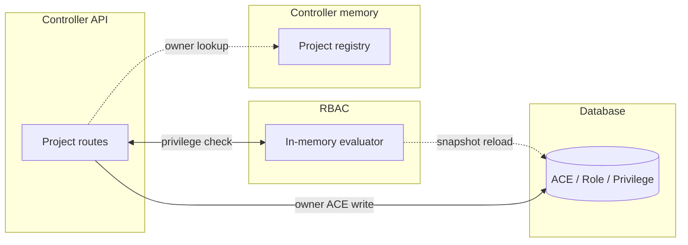
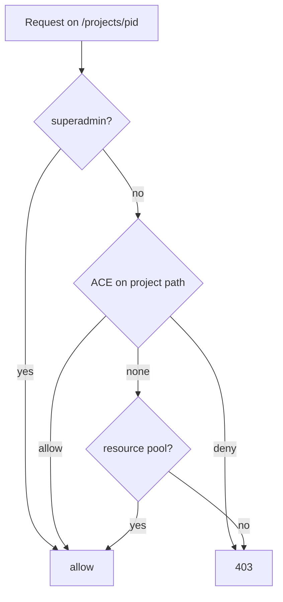
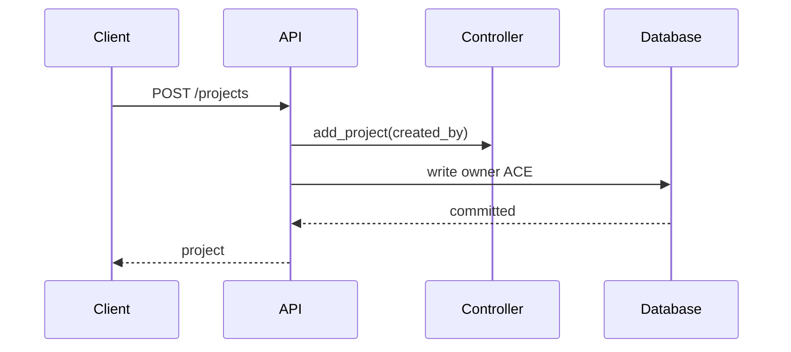

# Project Ownership (RBAC)

## Overview

Projects are private to their creator by default. The default ACE granting the `User` role to the `Users` group on `/projects` does not propagate: it only covers the collection endpoints. Every project gets a per-project owner ACE when it is created, imported, duplicated or loaded from disk, and access to an existing project is only granted by an ACE on its own path or by a resource pool. Projects without a resolvable owner stay restricted to superadmins.

This replaces the previous model, where the `created_by` field only filtered the project list while the propagated `/projects` ACE granted every user access to every project by ID.

## Terms

| Term | Meaning |
|---|---|
| Collection ACE | The default `Users` group ACE on `/projects` with `propagate=false` |
| Owner ACE | A user ACE on `/projects/<project_id>`, `propagate=true`, carrying the role of the project creator |
| Ownerless project | A project whose `created_by` is empty, or references a user that no longer exists |

## Architecture

The evaluator keeps the complete ACE state in a process-wide snapshot. A write to the ACE tables only flags the snapshot as dirty; the next check reloads it from the database, so project creation does not add a database round trip to the request path beyond the owner ACE write itself.

## Business Process

### Access decision

An explicit ACE on the project path always wins (a deny included). Without one, a resource pool covering the project grants access. The collection ACE is not an ancestor grant because it does not propagate.

### Project creation

The owner ACE is written in the same request that creates the project. On failure (for example a database error) the project is still loaded by the next directory scan, which backfills missing owner ACEs.

The same pattern applies to imports (the importer becomes the owner), duplicates (the duplicating user becomes the owner) and projects loaded from disk (the owner is read from the `.gns3` file).

## API Endpoints

| Method | Path | Description | Privilege |
|---|---|---|---|
| `GET` | `/v3/projects` | List the projects accessible through an ACE or a resource pool; no `created_by` filter anymore | login only |
| `POST` | `/v3/projects` | Create a project and its owner ACE | `Project.Allocate` |
| `POST` | `/v3/projects/{project_id}/duplicate` | Duplicate a project; the new project gets an owner ACE for the caller | `Project.Audit` |
| `POST` | `/v3/projects/{project_id}/import` | New target ID: collection check, then owner ACE for the importer; existing target ID: `Project.Allocate` on that project | `Project.Allocate` |
| `POST` | `/v3/projects/load` | Load a project from a local path; now `Server.Modify` and local server only | `Server.Modify` |
| `GET` | `/v3/projects/{project_id}` | Read a project | `Project.Audit` |
| `DELETE` | `/v3/projects/{project_id}` | Delete a project and all ACEs under its path | `Project.Allocate` |
| `POST` | `/v3/copilot/projects/{project_id}/chat/*` | Chat endpoints now require access to the project; chat sessions are also checked against the current user | `Project.Audit` |

The project-scoped routes not listed here keep their privilege names; they are covered by the owner ACE through path propagation (`/projects/<project_id>/nodes/...` and so on), including the console and notification WebSockets.

## Notes

- **Upgrade**: the migration flips only the exact seeded `/projects` ACE (`Users` group, `User` role, allowed, propagating). An ACE an administrator customized is left untouched. Existing projects get their owner ACE at the next startup, after the projects are loaded from disk.
- **Administrator escape hatch**: a propagating ACE on `/projects` (or on `/`) still grants every project; administrators can create it explicitly. This is how a deployment that wants the old shared model restores it.
- **Ownerless projects**: no ACE is created for them, so they are only reachable by superadmins until an administrator grants an explicit ACE or a pool membership. This covers projects created before `created_by` existed and projects whose owner user was deleted.
- **User deletion**: the owner ACE is removed by the foreign key cascade, so the user's projects become superadmin-only. The deletion endpoint logs the affected project names.
- **Idempotence**: the startup/directory-scan backfill only adds a missing owner ACE for the resolved creator; it never replaces an existing ACE or undoes an administrative change.
- **Owner role**: the owner ACE carries the role that allowed the creation (the effective ACE on `/projects`), falling back to the built-in `User` role. Custom roles therefore keep working without code changes.
- **Known limitation**: ownership is stored in the `.gns3` file as a username. The owner ACE itself is keyed by user id, but the backfill path still needs the username to resolve the user.
