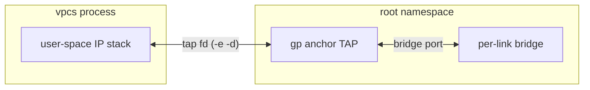

<!--
SPDX-License-Identifier: CC-BY-SA-4.0
See LICENSE file for licensing information.
-->

> This documentation is AI-generated with reference to actual code and verified against real-kernel testing. AI can make mistakes — please verify against the source code when in doubt.

# VPCS kernel datapath

A VPCS node's single adapter anchors on a **persistent TAP** that the server creates and the vpcs process *attaches to* (`vpcs -e -d <anchor> -n`), the same server-creates/guest-attaches shape as QEMU's netdev. Links between a VPCS node and any other anchoring node type on the same compute are wired in the kernel (per-link Linux bridge) instead of the uBridge UDP relay; the compute side is the shared `KernelDatapathMixin`, which is anchor-agnostic.

## Architecture

The anchor follows the shared naming contract of `gns3server/utils/kernel_anchor.py`: `gp{node_id[:8]}e0p0` (14 chars, within the kernel's 16-byte `IFNAMSIZ`). uBridge creates it at node start (`tap create`, `tap set_owner <uid>`, `link set down`) before the vpcs process is launched; vpcs opens it by name with `-e -d` and speaks its user-space IP stack through the tap fd. The per-link bridge, filters, capture, markers and suspend all ride the same mixin paths as every other anchor-backed node type — including the Ethernet switch fast path (a switch link absorbs the `gp` anchor into the switch's own bridge).

## The three vpcs-side requirements

The stock vpcs build cannot carry this datapath; three things have to be true of the binary, all verified against [the vpcs fork](https://github.com/GNS3/vpcs):

* **`-n` (no host auto-configuration)** — without it, every guest `ip` command runs `ifconfig <tap> <addr> netmask <mask> up` on the *anchor itself*: the server owns the anchor's addresses and bridge membership, so the guest reconfiguring it ranges from noise (a failed `ifconfig` on a name that cannot resolve) to sabotage (an address on an L2-only anchor). `-n` also needs the `ifconfig` to follow the `-d` name when it does run — the stock build hardcodes `tap0`.
* **`-d` only in single-VPC mode** — `-i 1` is how the server always launches vpcs, so this is free.
* **`IFNAMSIZ`, not `IFNAMESIZ`** — upstream vpcs has a one-letter bug: `globle.h` defines its own `IFNAMESIZ 12`, `open_tap()` sizes its name buffer with it (`char dev[IFNAMESIZ]`) while the length guard checks the kernel's `IFNAMSIZ` (16). A 14-char anchor name passes the guard, overflows the 12-byte buffer, and reaches `TUNSETIFF` truncated to 12 chars — a nonexistent device, which the kernel tries to *create*, which needs `CAP_NET_ADMIN`, which the unprivileged vpcs does not have: `EPERM`, every time. The fork uses `IFNAMSIZ` consistently (worth an upstream PR; names up to 12 chars never trip it, which is why four years of `-d tap0` never noticed).

## Gating and fallback

A compute reports two capabilities for this (`/capabilities`, probed like every other kernel-datapath capability): `ubridge_tap` (uBridge's persistent-TAP module) and `vpcs_tap` (the binary answers `-n` in its usage — probed once per binary identity). A kernel link needs both strict-True on the compute; anything else keeps the node on the relay, where it always works. The node also decides its own datapath at start: without the probes it keeps the legacy local-UDP-tunnel shape (`-s/-c/-t` to the uBridge relay), with them it anchors and a relay link rides the anchor as an AF_PACKET endpoint — the relay-mode negative control covers both shapes.

## Stop order and the delete race

The vpcs process holds the anchor's fd, so stop is the QEMU order: terminate the process first, then `tap delete` — a held device refuses deletion and the suppressed delete would leak it. vpcs's daemon parent additionally kills its console child and exits *before* the child's fds are actually released, so the server can reap the tracked parent while the tap is still held: the shared `_delete_anchor_taps` now verifies each tap is gone from `/sys/class/net` and retries a bounded three times with a grace period (this race is not VPCS-specific — any holder that releases its fd a beat after its process was reaped hits it).

## Verified (real kernel, real vpcs)

The e2e scenario (`tests/e2e/test_vpcs_kernel_datapath.py`) drives two real VPCS nodes through the controller API and their TCP consoles:

* kernel link reports `kernel_datapath`, anchors exist from node start, the per-link bridge enslaves exactly the two of them; real ICMP crosses the tap-fd leg both ways;
* the L2-anchor spec §E.1 (the anchor stays address-free — the assertion `-n` exists for) and §E.2 (a VPCS sends nothing spontaneously, so the silence window needs no guest shutdown);
* `delay 100` lands as netem on both anchors (RTT grows ~200 ms); suspend admin-downs the anchor and kills the traffic; a capture on the link writes a real pcap;
* link delete releases the anchor but it survives (the running vpcs holds it); re-creating the link re-enslaves it;
* node stop terminates vpcs, deletes the anchor and the orphan bridges; a restart recreates the TAP, rewires the link from the NIO and the reconfigured VPCS pings again;
* deleting the project leaves no anchors and no bridges behind;
* the relay negative control (isolated relay-configured instance) wires nothing into the kernel and still pings, with the relay filters served by the uBridge bridge engine — verified with both the fork binary (relay on the anchor) and a stock binary (the legacy UDP tunnel).
