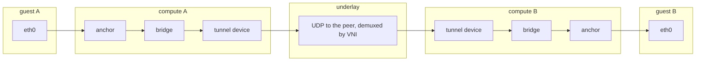
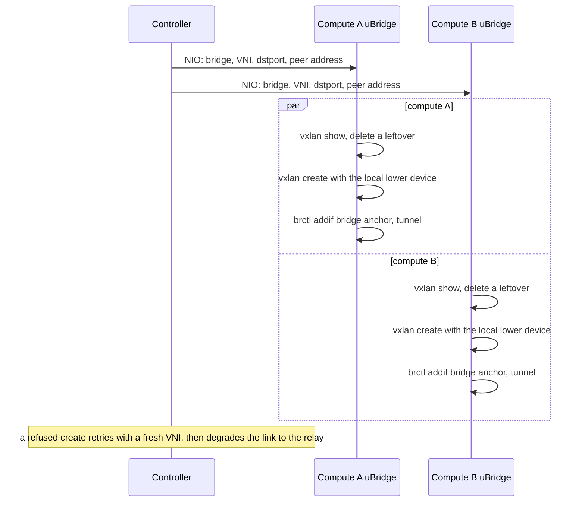

# Cross-compute VXLAN links

## Overview

A link whose endpoints live on two different computes normally flows through the uBridge UDP relay: each end's anchor is attached to a userspace relay bridge and the frames cross the network as plain UDP payloads pumped by uBridge. This feature adds a second, **kernel-native** cross-compute datapath: each end creates a **VXLAN device** (uBridge's `vxlan` module, rtnetlink) and enslaves it into the same per-link kernel bridge the same-host datapath uses, so the kernel encapsulates and decapsulates and no userspace process is on the data path.

It is **opt-in and off by default** (`Server.enable_vxlan_cross_compute`). The reason is MTU: a tunnel can only carry what the underlay carries minus the outer headers, so its sweet spot is a fabric that moves jumbo frames. The relay stays the default cross-compute datapath and the fallback whenever a tunnel cannot be wired — it always works, at the price of a userspace hop.

## Terms

| Term | Meaning |
|---|---|
| Anchor | The host-side interface an adapter owns (a veth host end, a persistent TAP); links attach *to* it, never create it |
| Relay | The default cross-compute datapath: uBridge userspace bridges pumping UDP tunnels between the computes |
| Tunnel device | The per-end VXLAN device (`gvl…`) carrying one link's frames to the peer compute |
| VNI | The VXLAN network identifier — the kernel's demux key for received frames; both ends of a link must use the same one |
| dstport | The UDP port every tunnel of a deployment listens on; the kernel serves one socket per port and demuxes its traffic by VNI |
| Lower device | The underlay interface the route to the peer resolves to; the kernel derives the tunnel's MTU from it |

## Architecture

Everything on the anchor side is shared with the same-host kernel datapath: filters (the full tc surface including the netem extensions the relay cannot run), markers, capture and suspend all run on the anchor, so they behave identically on a tunneled link. The controller picks the VNI and the device names and hands the peer's address to each end; the kernel does the rest. The device names are a pure function of the link id (bridge, `gvl` device) and the endpoint's node id (device), so each machine can recognise its own leftovers without asking anyone.

## Datapath selection

The controller's `UDPLink._kernel_datapath_eligible` decides at NIO prepare time, on every link (re)creation:

| Condition | Outcome |
|---|---|
| Both endpoints on one compute, both able to anchor | Kernel link (per-link bridge, unchanged) |
| Cross-compute, `enable_vxlan_cross_compute` on, both computes report `ubridge_vxlan`, both ends anchorable, addresses on a common subnet and distinct | **VXLAN tunnel** |
| Same-host pair (both computes resolve to one address) | Relay — the kernel keeps one socket per dstport, so a tunnel pair collides with itself on one host |
| Ethernet switch on either end (cross-compute), serial / non-Ethernet ports, unix-socket vendor containers | Relay |
| Capability missing, flag off, or the link was already downgraded | Relay |

On project (re)open every link re-runs the same decision, so flipping the flag upgrades or downgrades links the same way the same-host datapath is chosen.

## Link creation

Each end's compute owns its own machine: it resolves the lower device from the peer address locally, creates the device and enslaves it. The resolution is per tunnel, not a host setting: a connected UDP socket makes the kernel run the route lookup for the peer (nothing is sent), the chosen source address is matched back to the interface that holds it, and that interface becomes the `dev=` — carrying both the derived MTU and the outer source address along the actual routed path, policy routing included. Two peers reachable through different interfaces therefore ride different lower devices with independently derived MTUs; a peer with no route, or a source address no interface owns, is a wiring error and the link degrades to the relay. The two sides never talk to each other; the controller's VNI is what makes them a pair.

The `vxlan show` step is the idempotency contract: a device found under the link's deterministic name belongs to this link (a crashed run's leftover, the previous instance of a node restart) and is replaced, never refused. A create that fails with the name free can only be the VNI — the kernel refuses one already registered on the shared socket — so the controller bumps the derivation salt and retries, and after the retries run out it marks the link downgraded and rebuilds it on the relay. The same shape covers project open: a refused entry is reported per link by the batch route, retried on fresh VNIs up to the same candidate count an interactive creation gets, then degraded, so a VNI collision can never make a project unopenable. And a link wired while its nodes were stopped meets its collision only at node start — the controller's `Node.start` recognises the refused device (its name names the link), stops the half-started node, re-wires the link on a fresh VNI or, on a second refusal, degrades it to the relay, and retries: no path can fail permanently over a VNI.

## Interfaces

| Interface | Where | Notes |
|---|---|---|
| `nio_bridge.vxlan` (name, vni, remote, dstport) | Compute API, NIO create/update body | Present only on cross-compute kernel links; ignored by update (the device persists) |
| `ubridge_vxlan` | `GET /capabilities` and `GET /computes/{id}` | Probed with a scratch create/delete on a scratch port; `null` (unknown) keeps links on the relay |
| `kernel_datapath` | Link REST payload | True for tunneled links, like any kernel link |

## Configuration

| Key | Default | Meaning |
|---|---|---|
| `Server.enable_vxlan_cross_compute` | `false` | Wire eligible cross-compute links as VXLAN tunnels |
| `Server.vxlan_dstport` | `4789` | The UDP port all tunnels of the deployment listen on (one kernel socket per port; the IANA-assigned VXLAN port — change it when other VXLAN software on the computes already owns it, since a shared socket merges demux tables) |

## Known caveats

* **MTU is the whole story.** The kernel derives the tunnel device's MTU from the lower device (`underlay − 50` for an IPv4 underlay, `− 70` for IPv6; the 50 is 20 outer IPv4 + 8 UDP + 8 VXLAN + 14 inner Ethernet header — a VXLAN packet carries the guest's complete inner frame, per `vxlan_headroom()` in `include/net/vxlan.h`) and the per-link bridge, which carries no MTU of its own, reports the minimum of its ports — i.e. the derived value. A frame past it is dropped at the bridge egress **silently** (no ICMP, no log), which is why the datapath is opt-in: on a 1500-byte fabric a tunnel caps guests at 1450 while the relay carries 1500 with no tax. Guests set their own interface MTU, exactly like a VM or container raising eth0 on the same-host datapath.
* **Asymmetric underlays give one-way jumbo.** The derivation is per machine: a 9000-MTU compute paired with a 1500-MTU one forwards large frames in one direction only. Keep the fabric's MTU uniform between computes.
* **The MTU is derived at device creation and never tracks the underlay afterwards** — the vxlan driver registers no `NETDEV_CHANGEMTU` handler. Re-creation re-derives — and re-resolves the lower device, so a route change is picked up with it — and the wiring path deletes and re-creates the device (`_ensure_vxlan_device`) on every node start and link (re)creation, so the operational fix is: change the underlay MTU on **both** computes, then stop/start the nodes (or re-create the link, or reopen the project). A manual `ip link set <tunnel> mtu` on a live deployment also sticks: the bridge, unlike the tunnel, follows its ports' MTU at runtime (`NETDEV_CHANGEMTU → br_mtu_auto_adjust`), up and down, as long as the bridge MTU was never set by hand — ours never is.
* **VNI collisions self-heal, not never happen.** The VNI is drawn from the upper VNI space (1M–16.7M) but two links of one deployment can still collide on a host. Every path where the kernel's refusal can surface carries its own heal: link creation retries a fresh VNI then degrades to the relay, project open re-dispatches refused entries the same way, and node start (a link wired while its nodes were stopped) stops the half-started node, re-wires the link on a fresh VNI or degrades it on a second refusal, and retries the start. A reopen re-rolls every link's VNI, so an unlucky link is not permanently unlucky.
* **Security is the relay's, unchanged.** VXLAN carries no authentication; the VNI and the shared port are the only demux, and anyone who can reach the port can inject into any VNI. Treat the compute fabric as trusted, exactly as for the relay's UDP tunnels.
* **Same-host compute pairs stay on the relay**, as do switch links, serial ports and unix-socket vendor containers — the tunnel is a per-link-bridge shape, and those cases are not (or would collide with themselves on one host).

## Verification

* Unit: `tests/controller/test_kernel_datapath_link.py` (selection matrix, tunnel spec derivation, VNI retry, downgrade), `tests/utils/test_vxlan.py`, `tests/compute/docker/test_docker_kernel_datapath.py` (device lifecycle, leftover replacement, teardown ordering), `tests/api/routes/compute/test_capabilities.py`.
* Live: no automated scenario — a second network stack on one machine means a network namespace, which needs root and host-specific routing and proved too environment-coupled for the suite. Validate on a real two-compute deployment (two machines, or a namespace-isolated second server): both ends agree on the VNI and dstport, each per-link bridge enslaves exactly `[anchor, tunnel]`, the derived MTU crosses while one past it is dropped at the bridge egress, traffic and filters behave as on the same-host datapath, and link delete plus project close/reopen leave no devices behind.

## Roadmap

* PMTU probing between computes to pick the datapath (and pin the MTU) per pair instead of a deployment-wide flag.
* Ethernet switch links tunneled through the switch's own bridge (the absorbed-anchor shape) instead of falling back to the relay.
* VNI-space bookkeeping to make collisions impossible by construction rather than self-healing.
